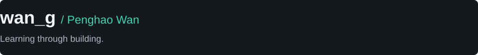

  

  <a href="https://vvph.loc.cc/">个人博客</a> ·
  <a href="https://github.com/wan-g11?tab=repositories">我的仓库</a>

---

## 关于我

- 深圳技术大学学生，目前正在实习。
- 关注 AI Agent、RAG 和实用开发工具。
- 持续学习 Python、Linux 与应用开发，喜欢通过动手实践理解技术。
- 在个人博客记录技术笔记、学习心得和生活。

---

## 正在学习与使用

**语言与工具**

  
  
  

**关注方向**

  
  
  

---

## 个人项目

目前个人项目均为闭源，暂时无法公开源码。后续计划开发个人项目或开源项目，持续完善功能与使用体验。

---

## 我的博客

使用 Hexo 搭建的个人博客，记录技术探索、学习过程与生活片段。

[访问博客](https://vvph.loc.cc/) · [查看博客仓库](https://github.com/wan-g11/wan-g11.github.io)

---

保持好奇，持续实践。

